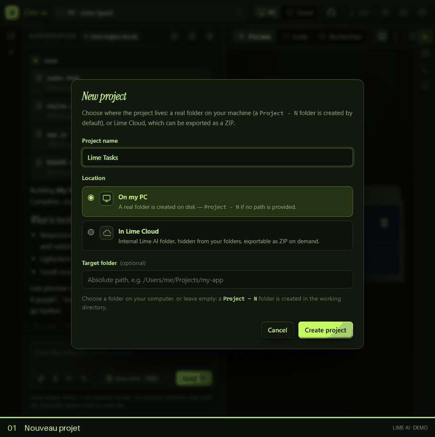
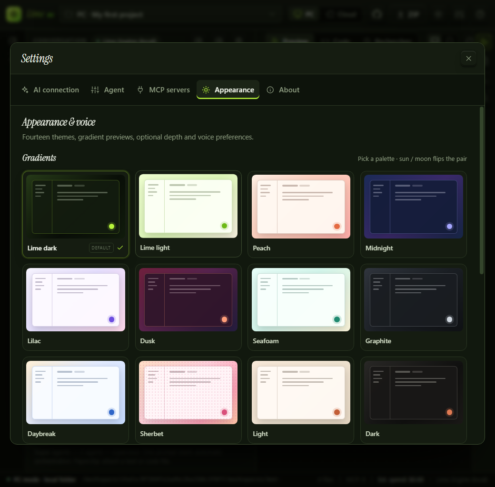
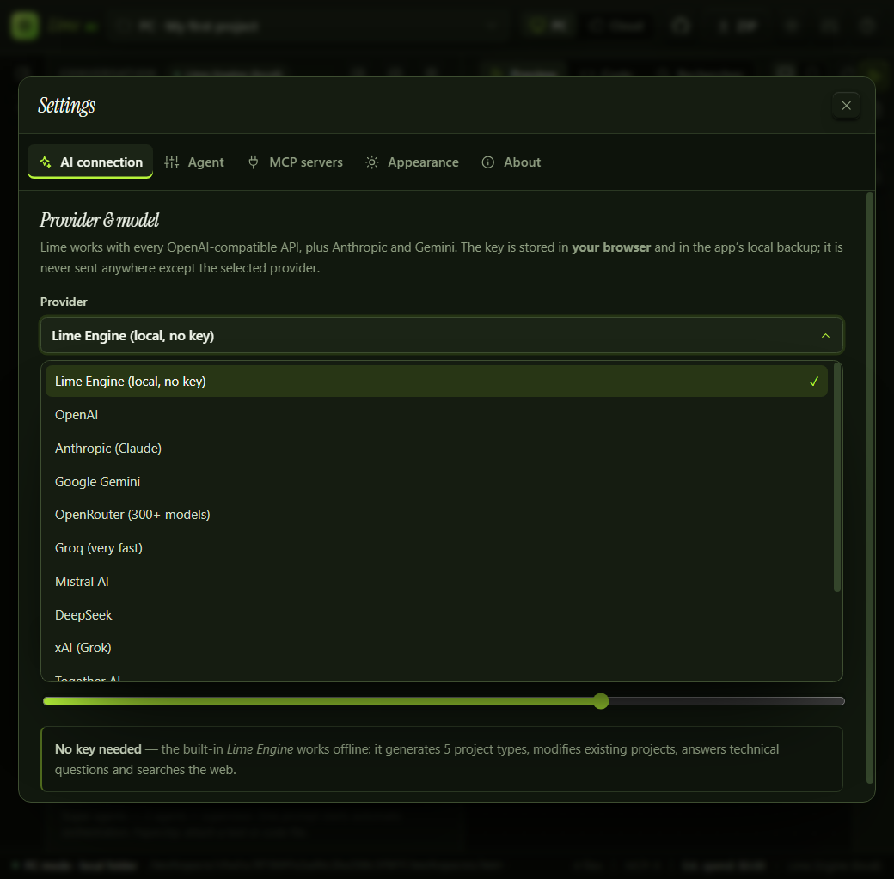
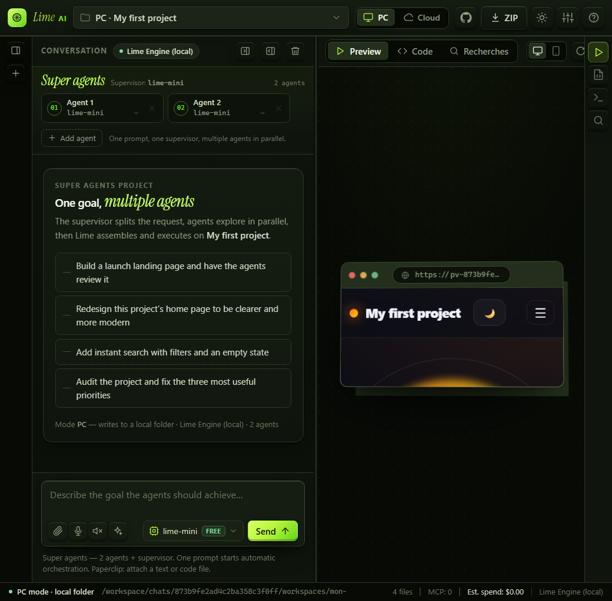
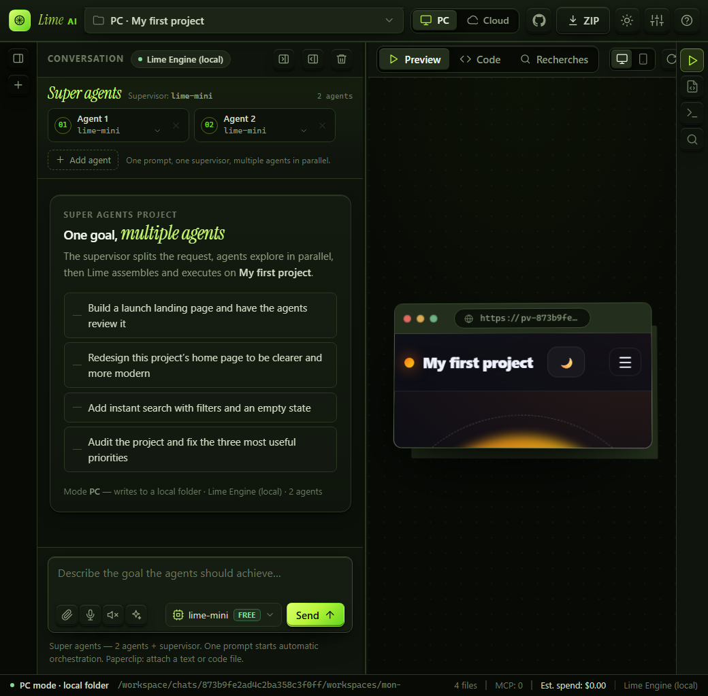
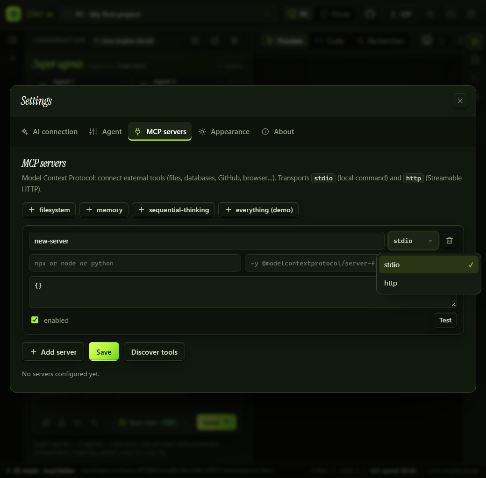

# ✦ Lime AI

[](LICENSE)
[](https://github.com/lemonlimeacid/lime-ai/releases/tag/v1.0.3)
[](#application-desktop)

Agent de code **local** qui mélange la boucle d'action d'un **Claude Code** (fichiers, shell, outils MCP)
et l'expérience d'un **bolt.new** (aperçu live, code, terminal, console, journal).

L'interface tourne sur `localhost` dans le navigateur et se décline aussi en **application de bureau Electron** (Windows, Linux, macOS).

```bash
npm install
npm start
# → http://localhost:3000
```

Aucune clé n'est nécessaire pour démarrer : le **Lime Engine** intégré fonctionne hors ligne.

> **Lime AI 1.0.3** — 14 thèmes à dégradés, menus déroulants entièrement thémés,
aperçu remis à zéro à chaque nouvelle conversation, agent local multi-API et MCP.

## Démo



Démo enregistrée avec le Lime Engine local, sans clé API : nouveau projet → prompt → génération des fichiers → vue Code → aperçu live. [Ouvrir le GIF en grand](docs/screenshots/demo.gif).

---

## Ce qu'il sait faire

| Domaine | Détail |
| --- | --- |
| **Compatibilité API** | Toute API « OpenAI compatible » (`/v1/chat/completions`) : OpenAI, OpenRouter, Groq, Mistral, DeepSeek, xAI, Together, Ollama, LM Studio, vLLM, llama.cpp… + **Anthropic** et **Google Gemini** en natif. URL de base, modèle et clé modifiables. |
| **MCP** | Client Model Context Protocol écrit sans dépendance : transport `stdio` et `http` (Streamable HTTP), `initialize`, `tools/list`, `tools/call`, boucle de continuation avec les résultats. |
| **Prévisualisation** | Bascule **Aperçu live / Code**. Le code contient 4 onglets : **Fichiers** (arborescence + éditeur), **Terminal**, **Console** (logs/erreurs de l'app) et **Journal** des actions. L'aperçu est vidé à chaque nouvelle conversation et se recharge au premier fichier écrit. |
| **PC / Cloud** | **PC** : vrai dossier sur la machine, écriture disque. **Cloud** : dossier interne à Lime AI, export **ZIP** en un clic. |
| **Vocal** | Dictée via la Web Speech API + synthèse vocale des réponses (par réponse ou automatique). |
| **Moteur local** | 5 générateurs de projets complets (vitrine, to-do, calculatrice, jeu serpent, météo), retouches ciblées (palette, thème, titre, finitions), base de connaissances technique, recherche web (DuckDuckGo + Wikipédia). |
| **Agent** | Écriture de fichiers complets, suppression, commandes shell avec approbation, outils MCP, prompt système personnalisable, amélioration de prompt. |
| **Confort** | Historique par projet, régénération, copie, arrêt de génération, raccourcis clavier, responsive, 14 thèmes à dégradés, profondeur 3D et menus déroulants thémés. |

---

## Interface

```
┌──────────────────────────────────────────────────────────────┐
│ ✦ Lime AI   [projet ▾] [PC | Cloud]             [ZIP] ⚙ ? │
├───────────────────────────┬──────────────────────────────────┤
│ Conversation              │  [▶ Aperçu live] [</> Code]      │
│                           │  ┌────────────────────────────┐  │
│  vous →                   │  │  aperçu de l'app / fichiers │  │
│  agent ←  fichiers, shell │  │  terminal / console / log   │  │
│                           │  └────────────────────────────┘  │
│ [🎙 🔈 ✨] [Envoyer]       │                                  │
└───────────────────────────┴──────────────────────────────────┘
```

- **Aperçu live** : iframe servie par le serveur, rafraîchie à chaque fichier écrit ; bascule bureau/mobile ; URL personnalisable (utile pour un serveur de dev Vite/Next). Une nouvelle conversation repart d'un aperçu vide.
- **Thèmes** : galerie de 14 palettes avec aperçus dégradés, paires clair/sombre et profondeur 3D optionnelle.
- **Code** : éditeur avec sauvegarde (`Ctrl+S`), création/suppression de fichiers.
- **Terminal** : vrai shell (`bash -lc`) à la racine du projet, historique ↑/↓. Les commandes de l'agent y apparaissent aussi.
- **Console** : les `console.log` et erreurs de l'app prévisualisée remontent ici.
- **Journal** : chaque fichier écrit, commande lancée et outil MCP appelé, horodaté.

### Aperçus

**Galerie de thèmes** — 14 palettes avec aperçus dégradés, paires clair/sombre et profondeur 3D optionnelle.



**Menus déroulants** — menus entièrement thémés, y compris les selects ajoutés dynamiquement.



**Aperçu live** — conversation, aperçu de l’application et espace de travail dans une seule vue.



**Super-agents** — un superviseur et plusieurs modèles qui travaillent en parallèle.



**Serveurs MCP** — connexion de serveurs stdio ou HTTP et découverte de leurs outils.



---

## Connexion d'un modèle

**Paramètres → Connexion IA.**

| Fournisseur | URL de base | Clé |
| --- | --- | --- |
| Lime Engine | — | aucune |
| OpenAI | `https://api.openai.com/v1` | `sk-…` |
| Anthropic | `https://api.anthropic.com` | `sk-ant-…` |
| Gemini | `https://generativelanguage.googleapis.com/v1beta` | clé AI Studio |
| OpenRouter | `https://openrouter.ai/api/v1` | `sk-or-…` |
| Groq | `https://api.groq.com/openai/v1` | `gsk_…` |
| DeepSeek | `https://api.deepseek.com/v1` | `sk-…` |
| Ollama | `http://127.0.0.1:11434/v1` | aucune |
| LM Studio | `http://127.0.0.1:1234/v1` | aucune |

> La clé est conservée dans le `localStorage` du navigateur et dans la sauvegarde locale
> `data/.user/state.json`. Le dossier est masqué et le fichier est lisible uniquement par le
> compte utilisateur, mais il **n'est pas chiffré** : sur une machine partagée, laisse la clé vide
> ou protège ton compte. Elle ne transite que vers `localhost` et le fournisseur choisi.

Pour Ollama : `ollama serve` puis `ollama pull qwen2.5-coder:7b`.

---

## MCP

**Paramètres → Serveurs MCP.** Chaque serveur a un `id`, un nom, un transport et une commande (ou une URL).
Exemples officiels (Node requis) :

```json
{
  "servers": [
    {
      "id": "filesystem",
      "name": "filesystem",
      "transport": "stdio",
      "command": "npx",
      "args": ["-y", "@modelcontextprotocol/server-filesystem", "."],
      "enabled": true
    },
    {
      "id": "memory",
      "name": "memory",
      "transport": "stdio",
      "command": "npx",
      "args": ["-y", "@modelcontextprotocol/server-memory"],
      "enabled": true
    }
  ]
}
```

Ce fichier peut aussi être édité à la main : `data/mcp.json`.
L'agent voit les outils découverts dans son prompt système et les appelle avec
`<mcp tool="filesystem.read_file">{"path":"README.md"}</mcp>`.

---

## Le protocole d'action

Le modèle n'a pas besoin de *function calling* : il écrit du texte balisé, le serveur exécute.
C'est ce qui rend la compatibilité très large (y compris avec de petits modèles locaux).

```xml
<file path="index.html">…contenu complet…</file>
<delete path="vieux.css"/>
<shell>npm install</shell>
<mcp tool="memory.search_nodes">{"query":"projet"}</mcp>
```

- Le contenu d'un `<file>` est **complet** (jamais un diff).
- Les chemins sont relatifs et ne peuvent pas sortir du projet.
- Les commandes shell passent par une politique : *demander*, *automatique* ou *jamais*.
- Une fois les outils MCP exécutés, l'agent reçoit leurs résultats et continue (jusqu'à 3 tours).

---

## Modes PC et Cloud

| | **PC** | **Cloud** |
| --- | --- | --- |
| Emplacement | `workspaces/<nom>-<id>/` (ou un chemin absolu choisi) | `data/cloud/<id>/`, dossier interne à Lime AI |
| Écriture disque | oui | oui, dans le dossier interne (masqué de l'interface) |
| Export | ZIP | ZIP (bouton **⤓ ZIP**) |
| Prévisualisation | oui | oui |

Le bouton **⤓ ZIP** est toujours disponible ; le mode Cloud est pensé pour générer et récupérer
un projet sans choisir de dossier, tout en le gardant dans l'application.

## Sauvegarde locale partagée

Les conversations, les réglages et les préférences d'interface sont sauvegardés dans
`data/.user/state.json` (dossier masqué, écriture atomique, copie `state.json.bak`).
Ils survivent à la fermeture du site et sont partagés entre le site et l'application desktop.

- **Site seul** : le serveur écrit dans `data/.user/` et le navigateur s'y resynchronise toutes
  les 4 secondes. Un second onglet voit donc les mêmes conversations et réglages.
- **Desktop + site** : au démarrage, l'application desktop cherche un serveur Lime sur
  `127.0.0.1:3000`. S'il existe, elle s'y connecte et utilise la même sauvegarde. Sinon elle
  démarre son serveur embarqué en priorité sur le port 3000 : ouvrir `http://localhost:3000`
  dans un navigateur affiche alors la même interface et les mêmes données.
- **Dossier personnalisé** : `LIME_DATA=/chemin/partage` force le même dossier de données
  pour le site et le desktop. `LIME_WORKSPACES` fait la même chose pour les projets PC.
- Le fichier est protégé par les permissions du compte (`700` pour le dossier, `600` pour le
  fichier sous Linux/macOS, attribut caché sous Windows). Il n'est pas chiffré.

## Application desktop

```bash
npm run icons         # génère build/icon.png, icon.ico et icon.icns
npm run desktop       # lance l'application Electron
npm run dist:linux    # AppImage
npm run dist:flatpak  # Flatpak (flatpak-builder et runtimes requis)
npm run dist:win      # installateur NSIS + portable Windows
npm run dist:mac      # DMG + ZIP macOS
```

Les artefacts sont écrits dans `release/`. En desktop, les données sont stockées dans le
dossier utilisateur de l'application (`app.getPath('userData')`), pas dans le dossier du projet.
Si un site Lime tourne déjà sur le port 3000, le desktop s'y rattache ; sinon il démarre
son serveur embarqué sur ce port pour que `http://localhost:3000` partage la même sauvegarde.

> Construire un `.exe` depuis Linux demande Wine, une `.app` macOS doit être construite sur
> macOS, et Flatpak demande `flatpak-builder` avec ses runtimes. Les configurations et icônes
> sont fournies pour ces trois cibles.

### Téléchargements

| Plateforme | Format | Téléchargement |
| --- | --- | --- |
| **Windows x64** | Installateur NSIS | [Lime.AI.Setup.1.0.3.exe](https://github.com/lemonlimeacid/lime-ai/releases/download/v1.0.3/Lime.AI.Setup.1.0.3.exe) |
| **Windows x64** | Portable | [Lime.AI.1.0.3.exe](https://github.com/lemonlimeacid/lime-ai/releases/download/v1.0.3/Lime.AI.1.0.3.exe) |
| **macOS universel** | DMG (Intel + Apple Silicon) | [Lime.AI-1.0.3-universal.dmg](https://github.com/lemonlimeacid/lime-ai/releases/download/v1.0.3/Lime.AI-1.0.3-universal.dmg) |
| **macOS universel** | ZIP (Intel + Apple Silicon) | [Lime.AI-1.0.3-universal-mac.zip](https://github.com/lemonlimeacid/lime-ai/releases/download/v1.0.3/Lime.AI-1.0.3-universal-mac.zip) |
| **Linux x64** | AppImage | [Lime.AI-1.0.3.AppImage](https://github.com/lemonlimeacid/lime-ai/releases/download/v1.0.3/Lime.AI-1.0.3.AppImage) |

Les builds sont **non signés** : Windows SmartScreen ou macOS Gatekeeper peuvent demander une confirmation au premier lancement.

### Checksums SHA-256

Vérifier les fichiers avec `sha256sum -c SHA256SUMS` (Linux/macOS) ou `Get-FileHash` (Windows). Le fichier [`SHA256SUMS`](https://github.com/lemonlimeacid/lime-ai/blob/main/SHA256SUMS) est aussi attaché à la [release](https://github.com/lemonlimeacid/lime-ai/releases/tag/v1.0.3).

```text
485edbc952184762753398d85530fcab0ddc0874e55073bb60fe799c39b320be  Lime.AI-1.0.3-universal-mac.zip
28ca1790c8a168df34f1508179d0a0a496cf5a0cb1294fb30de832aae929caf5  Lime.AI-1.0.3-universal.dmg
869cb8729619d206459d1323f01b87402755edee018d0bc9bf7e048af1489bfe  Lime.AI-1.0.3.AppImage
cdf1aa472540b4cffd5fe0df3591c1c3cde34656adff5cc15b7ae79b42144fea  Lime.AI.1.0.3.exe
00179db35f2635cf45f2f0a269fdfca2c50ee8620878a2036e1e9109120863f1  Lime.AI.Setup.1.0.3.exe
```

---

## Structure

```
server/
  index.js        Express + SSE (chat) + WebSocket (terminal) + aperçu + ZIP
  agent.js        prompt système, parsing du protocole, shell, boucle MCP
  providers.js    OpenAI-compatible / Anthropic / Gemini / local
  local-engine.js moteur intégré + 5 générateurs de projets
  mcp.js          client MCP stdio + HTTP
  search.js       recherche web (DuckDuckGo + Wikipédia)
  store.js        projets PC/virtuels, fichiers, arborescence
  state.js        sauvegarde partagée réglages/conversations/interface
  zip.js          écriture ZIP (deflate + CRC32) sans dépendance
public/
  index.html      interface (une page)
  css/app.css     design
  js/core.js      état, réglages, API, markdown
  js/chat.js      streaming SSE, vocal, approbations
  js/workspace.js aperçu, éditeur, console, journal
  js/terminal.js  terminal WebSocket
  js/settings.js  paramètres + MCP
  js/select.js    menus déroulants thémés
  js/themes.js    registre des thèmes, paires et aperçus dégradés
  js/app.js       amorçage, projets, raccourcis
desktop/
  main.cjs        enveloppe Electron (serveur embarqué + fenêtre)
scripts/
  make-icons.mjs  génération des icônes desktop
build/            icônes générées (PNG, ICO, ICNS)
```

## Variables d'environnement

```bash
PORT=3000                     # port du site
HOST=127.0.0.1                # 0.0.0.0 pour exposer sur le réseau local
LIME_WORKSPACES=/chemin  # racine des projets PC
LIME_DATA=/chemin        # données : projets, Cloud, MCP, sauvegarde .user
LIME_SITE_PORT=3000      # port du site détecté par le desktop
LIME_DISABLE_SHELL=1     # coupe l'exécution de commandes
```

## Sécurité et limites

- Le terminal et l'agent exécutent de **vraies commandes shell**. Garde `HOST=127.0.0.1`,
  ne lance pas Lime sur un projet sensible, et vérifie les commandes proposées.
- L'aperçu live fonctionne pour des projets **statiques** (HTML/CSS/JS). Pour React/Vue/Next :
  `npm install` puis `npm run dev` dans le Terminal, puis colle l'URL du serveur de dev
  (ex. `http://localhost:5173`) dans la barre d'aperçu.
- Le **Lime Engine** n'est pas un LLM : il est rapide, hors ligne et honnête sur ses limites.
  Pour du code complexe, branche un modèle.
- La sauvegarde `data/.user/state.json` contient les conversations et les réglages, y compris
  la clé d'API si tu en as saisi une. Elle reste locale mais n'est pas chiffrée ; ne la copie pas
  sur un service de synchronisation non maîtrisé.
- Aucune télémétrie. Seuls les appels au fournisseur choisi et les recherches web sortent de la machine.

## Raccourcis

| Raccourci | Action |
| --- | --- |
| `Entrée` | Envoyer |
| `Maj` + `Entrée` | Aller à la ligne |
| `Ctrl` + `S` | Enregistrer le fichier ouvert |
| `Échap` | Arrêter la génération |
| `Ctrl` + `K` | Fermer les fenêtres |

## Licence

MIT © 2026 Lime AI. Voir [LICENSE](LICENSE).
